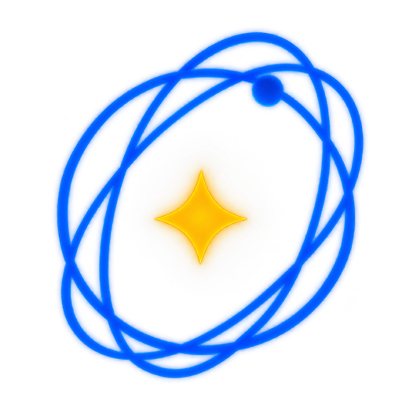

<p align="center">
  
</p>

<h1 align="center">NOVA MIND</h1>
<p align="center"><strong>Orbital Med-Bay · Autonomous Crew Health Deck</strong></p>
<p align="center"><a href="https://aresmed-eve4tknw.manus.space/">Open the live demo</a></p>

NOVA MIND is a browser-based orbital crew-health dashboard prototype. It brings simulated diagnostics, mission telemetry, crew-health trends, an interactive 3D anatomical guide, and a Flight Surgeon assistant into one interface.

> **Prototype and safety notice:** This project is for demonstration and training exploration only. It is not clinically validated and must not be used to diagnose, treat, triage, or make real medical or flight-safety decisions. The default readings and profiles are synthetic. Human medical review and mission-approved procedures are required.

## Features

- **Diagnostic grid and full-system sweep:** Explore 18 sample sensor channels spanning blood, urine, imaging, cardiovascular, respiratory, musculoskeletal, immune, radiation, and other domains. The exam flow is simulated unless a compatible bridge is configured.
- **Mission telemetry:** View glucose, oxygen saturation, heart rate, blood pressure, and radiation dose. Readings animate locally in simulation mode; an optional WebSocket bridge can provide telemetry updates.
- **Crew profile and health trends:** Review a sample crew record, baseline vitals, mission profile, health trajectory charts, and chronic-condition monitoring panels.
- **Medical history:** Search the sample log, switch between 24-hour and seven-day views, and export the visible records as JSON or CSV.
- **3D anatomical guide:** Switch between front and back views, choose a display preset, select body regions, view illustrative zero-gravity first-aid guidance, and run a simulated full-body scan.
- **Flight Surgeon assistant:** Use text chat, browser-supported voice input, and shortcuts to open tests, navigate dashboard sections, inspect vitals, highlight a body region, or start a scan. A local command-based fallback is available when the optional AI bridge is offline.
- **Evidence Intake:** The interface accepts PDF, JPG, PNG, and DICOM files. Genuine report analysis requires a configured backend; the disconnected fallback is demo text, not OCR or medical image interpretation.
- **AstraMed synthetic packet demo:** Submit sample results across 18 modalities and explore input-quality checks, optional sequence/duplicate handling, illustrative rule-based alerts, baseline updates, cumulative radiation tracking, and session history.

## Simulation, integrations, and data

The website starts in local simulation mode and does not require a backend to display its sample dashboard. Backend URLs can be set in **Settings → Backend connection**. The site bridge can connect to a compatible FastAPI service for chat, report upload, diagnostic requests, hologram inspection, and WebSocket telemetry. Its default addresses are `http://localhost:8000` and `ws://localhost:8000/ws/telemetry`.

The AstraMed panel uses the website's TypeScript rules in `src/services/astramedEngine.ts`. Its profiles, submitted packets, rolling baselines, radiation totals, and event assessments live only in the browser page session and reset when the page reloads. That panel does not send its synthetic records to a server. The separately retained Python prototype under [`integrations/astramed-original`](integrations/astramed-original/) is reference material; the website does not start or expose that service automatically.

AstraMed's scores and thresholds are illustrative software rules, not clinical probabilities or validated medical limits. The project does not implement raw image, DNA-sequence, or ECG-waveform interpretation, authenticated clinical accounts, or durable clinical-record storage.

## Run locally

Requirements: Node.js and pnpm. The project pins pnpm in `package.json`.

```bash
corepack enable
pnpm install --frozen-lockfile
pnpm dev --port 3000
```

Create a production build with:

```bash
pnpm build
```

## Project structure

- `src/App.tsx` — dashboard, navigation, health views, chat, telemetry, and exam flows.
- `src/data.ts` — sample diagnostic channels, profile, alerts, trends, and history.
- `src/components/HumanHologram3D.tsx` — Three.js hologram viewer.
- `src/components/AstraMedPanel.tsx` — synthetic multimodal packet interface.
- `src/services/astramedEngine.ts` — browser-local validation and transparent rule engine.
- `src/services/aiBridge.ts` — optional AI, upload, diagnostic, hologram, and telemetry bridge calls with local fallbacks.
- `integrations/` — integration notes and the separate original AstraMed prototype.

## Further documentation

- [AstraMed integration notes](integrations/README.md)
- [Standalone AstraMed prototype README](integrations/astramed-original/README.md)
